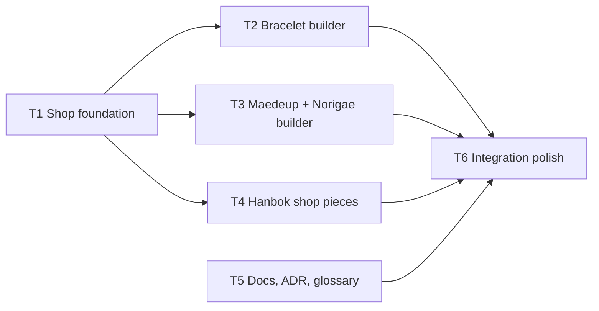

# Spec 0001: Webshop UI (no payment, nothing stored)

Status: approved by the founder in conversation (2026-10-27).
Tickets: [`tickets/`](./tickets/) (task graph at the bottom of this file).

## Problem

Customers can only look at the site. The founder wants a simple webshop where they can pick, and later buy:

1. **Bracelets** made of macramé cord and pearls/crystals, always with one **signature pearl**. Customers can design their own on the site.
2. **Maedeup with Norigae**: Korean decorative knotwork. Customers can design their own on the site.
3. **Hanboks** made from second-hand men's shirts (WEAR).
4. (Later, out of scope for this spec) **Petite sewing patterns** where the customer enters measurements and receives a custom digital PDF.

## Decisions already made

| Decision | Choice |
| --- | --- |
| Scope of this PR | Bracelets, Maedeup + Norigae, hanboks. Patterns are a follow-up. |
| Payment | **None in this PR.** No cart, checkout, payment, accounts or personal data. Stripe Checkout + a minimal serverless backend is a separate, later spec. |
| Storage | The builders and the order button store and send nothing. Builder state is local React state. The only thing the site keeps is the language choice, in the visitor's browser (`localStorage` key `hms-language`). |
| ADR 0001 and `.github/copilot-instructions.md` | Unchanged. This work stays inside their rules (forms inactive, no personal data). |
| Pattern PDFs (later) | Generated on the server after payment (recorded here so the follow-up spec starts from it). |

## Goals

- A shop section where bracelets, Maedeup/Norigae sets and hanboks are presented as products with prices shown as "price to be announced".
- A **bracelet builder** and a **Maedeup + Norigae builder**: live SVG preview, choices from the CONNECT palette and part library, one signature pearl always present.
- Hanbok product presentation that makes clear every piece is one of a kind (made from one second-hand shirt) and which measurements/choices matter for fit, without collecting any.
- Swedish and English, structurally identical (`Copy` type). No hard-coded visible text.
- Accessible: keyboard operable, labelled controls, live-region summary, passes the existing contrast and layout checks at 320 to 1440 px.

## Non-goals

- Cart, checkout, payment, accounts, email capture, order storage, shipping, VAT, stock.
- Real prices, real photography, real stock. (Placeholders are labelled.)
- Measurement-based pattern generation and PDF output.
- Sending a design anywhere. The only output of a builder is an on-screen summary the customer can copy to their clipboard (client-side only).

## Rules every ticket must follow

- Use the repo rules in `.github/copilot-instructions.md` and the vocabulary in `CONTEXT.md`.
- All visible text goes in `src/content/copy/{sv,en}.ts` under type `Copy` in `types.ts`. Colour names and product names stay English (`lang="en"`). WEAR/MAKE/ACCENTED are not translated.
- Language-independent data lives in `src/content/`. Reusable UI lives in `src/components/`.
- Drawings are graphic studies, not product photos. Label demo pieces and placeholders. Never present demo content as stock for sale.
- Inputs and buttons that would submit something stay inactive or are absent.
- Use the term **Maedeup** (not "maedup") and **Norigae**, with Hangul as secondary text if included (매듭, 노리개). Per repo memory, do not claim a documented knot technique; keep "inspired by Korean decorative knotwork" for generic text.
- Verify with `npm run build` and `npm run lint`.

## Task graph

Frontier at start: **T1** and **T5**. After T1: **T2, T3, T4**. T6 last.

Deferred follow-up (not tickets in this PR): F1 Stripe Checkout and backend. F2 petite pattern measurement form. F3 server-side PDF generation after payment.
