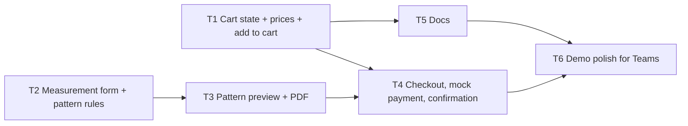

# Spec 0002: Prototype shop flow (cart, checkout, measured pattern)

Status: agreed with the founder in conversation (2026-10-28).
Governing decision: [ADR 0003](../../adr/0003-hardcoded-shop-prototype.md). Builds on [spec 0001](../0001-webshop-ui/spec.md).
Tickets: [`tickets/`](./tickets/). Task graph at the bottom.

## Problem

The site shows what can be chosen but not how a purchase would feel. The founder presents the site as a prototype on a school course (Teams screen share, 15 to 20 minutes shared with other projects, so the flow must fit in about two minutes). It must show one complete, mocked flow, and later be turned into a real shop without rewriting the parts that matter.

## Scope

In:

1. **Bracelets**: pick one of three designs, change colours (done in spec 0001 follow-up), add to cart.
2. **Maedeup + Norigae**: the customer builds their own, it is shown in the cart and the checkout, add to cart. For the presentation the founder clicks one together to match the founder's photograph.
3. **Measured pattern** (see `CONTEXT.md`): a shirt pattern following `proportion-study-01`. The customer fills in five measurements, a pattern is generated and previewed, and after the mocked payment it can be downloaded.
4. **Cart, checkout, payment, order confirmation, download**: one flow shared by the three items, all mocked.

Out:

- Hanbok is not purchasable. It stays a demo piece without a buy button.
- No real payment, accounts, backend, email, storage of any kind, shipping or VAT calculation, stock.
- Anything outside Sweden and SEK.

## Decisions already made

| Topic | Decision |
| --- | --- |
| Nature | Hard-coded prototype for a presentation. Mocked cart, payment and personal data (ADR 0003, whole site). |
| Market | Sweden, SEK, fictional prices labelled "demo". |
| Customer data | One fictional customer, "Kund Demo", pre-filled and editable. Every field says that nothing is saved or sent. |
| Cart storage | In memory only (React state). Gone on reload. The flow is easy to restart. |
| Navigation | Hash routes, no router: `#kassa` (checkout), `#bekraftelse` (confirmation). The back button works. |
| Pricing | A pure `price(...)` function per item kind in `src/content/`, separate from the UI. Fictional amounts, for example bracelet 350 kr, Maedeup + Norigae 450 kr, pattern 149 kr, small surcharges for crystals and long tassel. |
| Payment | A mocked button with a short delay (about 1.5 s) and a "Processing…" state, then the confirmation. No provider is called. |
| Pattern generation | Drawn in the browser as SVG by a pure function (five measurements in, pattern pieces out). No UI code inside it. |
| Pattern PDF | A fixed pre-made file in `public/`, made by the agent, marked "Prototype, not a real pattern" and showing the fictional customer's measurements. Not generated. |
| Measurements | Pre-filled for "Kund Demo", editable, five fields. "Generate pattern" requires all five to be filled and plausible. |
| Presentation | Teams screen share, layout checked at 1280 and 1920 px, mobile must keep working. Teams compresses video: no thin lines or small text that disappears, few and short animations. |

## The five measurements

For a shirt following `proportion-study-01` ("shorter upper body, balanced sleeve, hem where the garment falls right"):

| # | Measurement | What it drives |
| --- | --- | --- |
| 1 | Shoulder width | Width of back piece and sleeve cap |
| 2 | Bust | Width of front and back pieces |
| 3 | Upper-body length (neck to waist) | Height of the waistline, where petite most often differs |
| 4 | Sleeve length | Length of the sleeve |
| 5 | Desired garment length | Placement of the hem |

Waist and hip are left out because the shirt is straight. The exact rule for how each measurement changes each piece, and the plausible ranges for validation, are fixed in ticket T3 and written next to the function so the rules can be moved to a server later.

## Rules every ticket must follow

- `.github/copilot-instructions.md`, `CONTEXT.md` and ADR 0001 to 0003.
- All visible text in `src/content/copy/{sv,en}.ts` under type `Copy`. No hard-coded visible text.
- WEAR, MAKE and ACCENTED stay untranslated. Colour and product names stay English with `lang="en"`. Spell Maedeup and Norigae.
- Every screen in the flow shows "Prototype, no real order". Every field the visitor can type in is labelled as demo, with a line that nothing is saved or sent.
- No `fetch`, no `localStorage` (except the existing `hms-language`), no payment SDK.
- Business rules (prices, the cart, the pattern rules) live in `src/content/` or plain modules with unit-testable pure functions, not inside components. This is the seam to a real shop.
- Verify with `npm run build` and `npm run lint`, and check the layout at 320, 375, 768, 1280 and 1920 px in both languages.

## Task graph

Frontier at start: **T1** and **T2**. T6 last.

Deferred (not in this PR): real payment, accounts, server-side pattern and PDF generation, router, stock.
